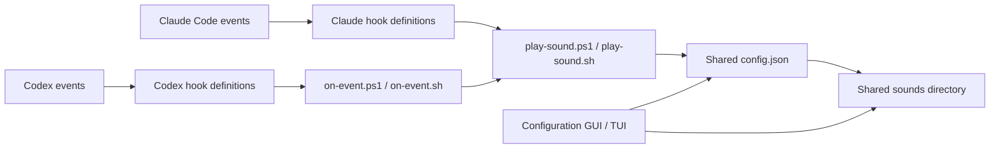

# DingDong Architecture

One source repository supplies both clients. Package directories are build/install outputs; user data is stored separately.



## Source layout

```text
dingdong/
  play-sound.ps1 / play-sound.sh    Shared players
  config-ui.ps1 / config.sh        Shared configuration tools
  configure.bat                   Windows configuration entry
  config.json / sounds/           Installation defaults
  hooks.json / hooks.unix.json    Claude Code event mappings
  .claude-plugin/                 Original Claude metadata
  integrations/codex/
    .codex-plugin/plugin.json      Codex manifest template
    hooks.json                    Codex event mappings
  scripts/
    data-paths.ps1 / .sh           Shared user-data location and initialization
    on-event.ps1 / .sh             Neutral Codex JSON output
    claude-settings.ps1 / .py      Preserve unrelated settings and hook handlers
    install.ps1 / .sh              Claude installation and migration
    uninstall.ps1 / .sh            Claude removal, shared data retained
    build-codex.ps1                Generate a self-contained Codex package
    update-codex.ps1               Back up, rebuild, validate and reinstall
  tests/test_integration.py        Disposable-directory integration checks
```

## Data and upgrades

Both clients read `~/.config/dingdong/config.json`, or the absolute `DINGDONG_HOME` override.
WAV paths are resolved relative to this configuration's directory unless absolute.
Installers and configuration tools seed user data only when missing. Existing files win.
Hooks can use bundled defaults before initialization, but never rewrite user data while playing sounds.

The Windows installer first imports the existing Claude installation's configuration and WAVs.
The Codex updater also initializes from its old source package if no shared configuration exists.
For two different legacy configurations, deliberately seed the desired configuration first; old cache-only customizations need to be copied before upgrading.

Codex packaging copies the repository's common players, UI, helpers and default sounds into its registered source directory.
Its versioned runtime cache is installed by the Codex CLI. Configuration is outside both directories, so cache replacement preserves settings.
Codex's `commandWindows` selects PowerShell on Windows; `command` selects Bash on Unix.

The root deliberately has no `hooks/hooks.json`: Claude must not auto-discover Codex-only hooks.
Codex's file appears at that path only inside the generated Codex package.

## Playback and protocol

- Windows: Unicode `winmm.dll PlaySound`, with missing-file/default-beep suppression.
- Unix: `afplay`, `paplay`, or `aplay`; JSON parsing uses working python3 or jq.
- Silent, unknown, or missing-file events do not block the clients.
- Codex wrappers discard stdin and return `{}`, including on playback/configuration errors.
- The Windows Codex wrapper deduplicates Stop callbacks by session/turn identity using atomically created empty hash-named files in shared `state/codex-stop/`. Markers expire after seven days; hook payloads are never persisted. Missing identities or unavailable state storage retain ordinary playback.
- Windows hook stdin is decoded as UTF-8 regardless of the console code page. Stop inputs with an explicitly empty/null transcript path are ephemeral and do not play task-completion audio; this includes background metadata generation and ephemeral CLI tasks. Inputs without that field retain legacy/manual behavior.
- Codex supports four configured events: Stop, PermissionRequest, PreToolUse, SubagentStop.
- User-input tool matchers include the synchronous and asynchronous tool names.
- Codex's normal hook trust flow is retained. Package installation and audio playback do not prove automatic hook activation.

The volume fields remain compatibility data; the players currently use system output volume.
